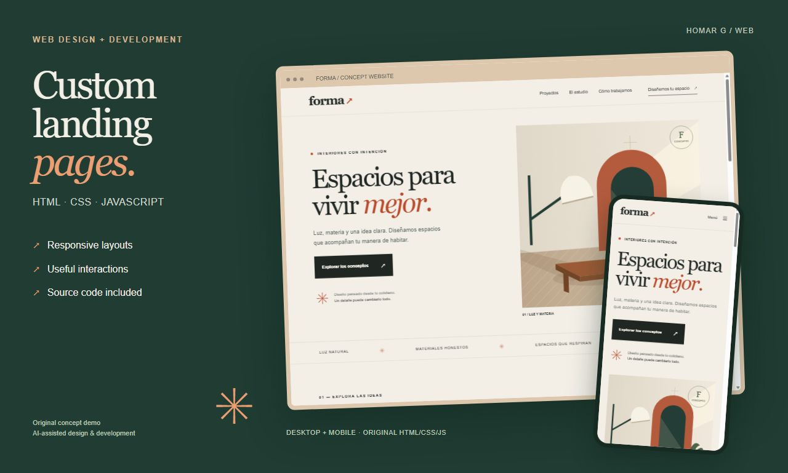

# Forma — responsive landing page

Original portfolio demonstration for **homargarcia**, built with HTML, CSS and JavaScript using AI-assisted tools. Forma is a fictional interior-design studio. The brand, illustrations and projects are demonstration concepts, not past client work.

## Features

- Responsive one-page layout with five sections.
- Residential/commercial project filters and an accessible result count.
- Mobile navigation that closes on link selection and Escape.
- Brief generator with required-field validation, a surface-area slider and a local UTF-8 text download.
- Semantic HTML, visible keyboard focus and original SVG/CSS illustrations.
- System fonts; no external libraries, installation or build step.

## Run locally

Open `index.html` in a browser. Keep `styles.css` and `script.js` in the same folder. Any ordinary static web server can also serve these files.

## Scope

The brief generator works locally: it does not send email, store submissions on a server or issue a real price quotation. This demonstration includes no backend, authentication, payments, hosting or domain.

The source is provided as a portfolio sample so that prospective clients can review the implementation.

## Validation

The original demonstration was reviewed in a browser at 1280 px and 390 px widths. Checks covered the page layout, project filters, mobile navigation, required fields and brief download. JavaScript syntax was checked. This is not a claim of accessibility certification or testing in every browser.

## Español

Muestra original de una landing page adaptable, con filtros de proyectos y generador de brief local. Código y diseño preparados con asistencia de IA. La marca y los trabajos mostrados son ficticios; no se presentan como encargos de clientes. Abrir `index.html` para probarla.
